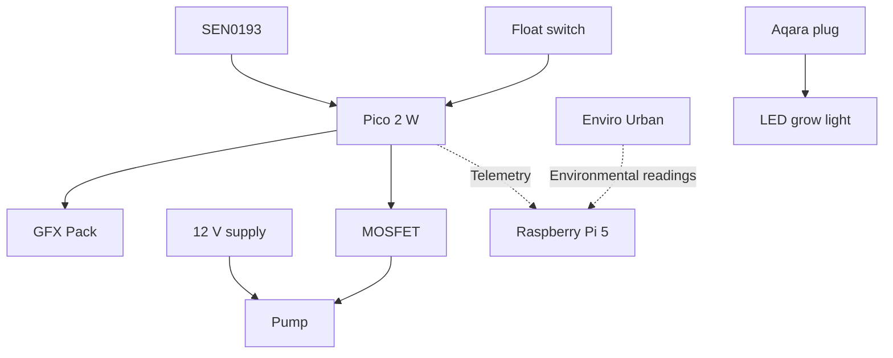

# Hardware and architecture

| Component | Purpose |
|---|---|
| Raspberry Pi Pico 2 W, Pimoroni Pico Proto | Controller and prototype assembly |
| Pimoroni Pico GFX Pack | Local display |
| DFRobot SEN0193 | Analog soil moisture sensing |
| 12 V peristaltic pump, Mean Well GST25E12-P1J | Water delivery and power |
| D4184 MOSFET module | Candidate driver; verify terminals and 3.3 V logic compatibility |
| Flyback diode | Select for pump ratings and verify before connection |
| Float switch, covered 1–2 L reservoir | Low-water detection |
| Silicone tubing, diffuser, 5.5 × 2.1 mm DC connectors | Water and power routing |
| SANSI E27 24 W, KOBI AURIQ E27, Aqara | Grow lighting and scheduling |
| Pimoroni Enviro Urban | Independent environmental sensing |
| Raspberry Pi 5 | Planned history storage and dashboard |

## Proposed architecture

This is a functional diagram, not a verified wiring schematic. Pump terminal assignments require verification of the actual MOSFET module. Keep 12 V away from Pico inputs. Place electronics above the reservoir and outside potential leak paths. Use a ready-made lamp holder rated for the lamp and follow manufacturer instructions.
