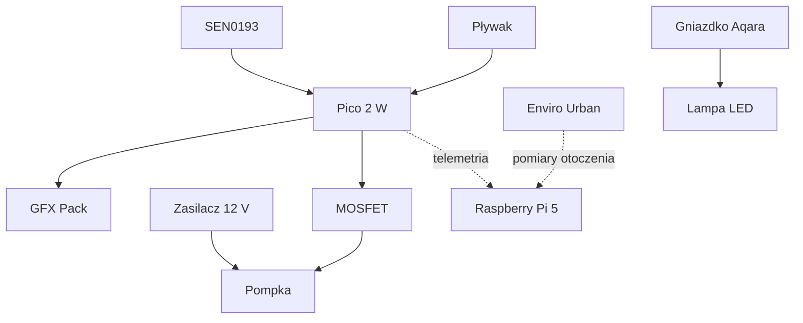

# Sprzęt i architektura

| Część | Przeznaczenie |
| --- | --- |
| Raspberry Pi Pico 2 W, Pimoroni Pico Proto | Kontroler i montaż prototypu |
| Pimoroni Pico GFX Pack | Lokalny podgląd |
| DFRobot SEN0193 | Analogowy pomiar wilgotności podłoża |
| Pompka perystaltyczna 12 V, Mean Well GST25E12-P1J | Obieg wody i jego zasilanie |
| Moduł MOSFET D4184 | Kandydat na stopień wykonawczy. Sprawdzić oznaczenia zacisków i działanie z sygnałem 3,3 V |
| Dioda zabezpieczająca | Dobrać do parametrów pompki i zweryfikować przed połączeniem |
| Pływak, zbiornik 1–2 l z pokrywą | Wykrywanie niskiego poziomu wody |
| Wężyk silikonowy, dyfuzor, gniazda DC 5,5 × 2,1 mm | Prowadzenie wody oraz zasilania |
| SANSI E27 24 W, KOBI AURIQ E27, Aqara | Doświetlanie i harmonogram lampy |
| Pimoroni Enviro Urban | Niezależne pomiary otoczenia |
| Raspberry Pi 5 | Planowany zapis historii i dostęp do panelu |

## Plan połączeń

Schemat pokazuje przepływ sygnałów i podział funkcji. Rozpiska zacisków obwodu pompy powstanie po sprawdzeniu konkretnego modułu MOSFET. Separuj zasilanie 12 V od wejść Pico. Umieść elektronikę powyżej zbiornika i poza drogą wycieku. Lampę używaj z gotową oprawą zgodną z jej mocą i wymaganiami producenta.
